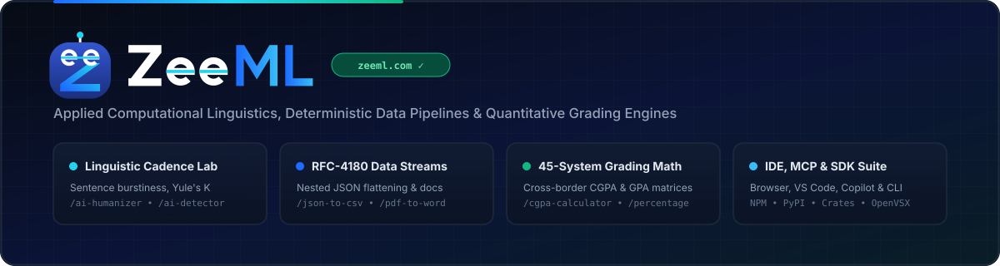

  
   
  

    <a href="https://zeeml.com"><strong>🌐 Official Platform (zeeml.com)</strong></a> •
    <a href="https://zeeml.com/tools"><strong>🛠️ All Interactive Workbenches</strong></a> •
    <a href="https://zeeml.com/about"><strong>📐 Engineering Methodology</strong></a> •
    <a href="https://zee-ml.github.io"><strong>📚 Developer Docs Portal</strong></a>
  

---

## ⚡ About ZeeML (`zeeml.com`)

**ZeeML** ([https://zeeml.com](https://zeeml.com)) is an applied engineering and research organization building deterministic data-transformation pipelines, syntactic cadence and burstiness analyzers, and cross-border academic grading normalizers.

Our tools execute interactive workflows directly in the browser and across developer IDEs (VS Code, OpenVSX, JetBrains, GitHub Copilot, and Antigravity MCP), backed by open benchmark datasets and zero-dependency libraries in JavaScript/TypeScript, Python, Rust, Go, PHP, Ruby, C#, and Dart.

---

## 🧭 Live Interactive Web Workbenches on [`zeeml.com`](https://zeeml.com)

| Domain Pillar | Live Interactive Tool | Primary Engineering Capability | Direct Workbench Link |
| :--- | :--- | :--- | :--- |
| **Computational Linguistics & AI Cadence** | **AI Text Humanizer** | Rebalances sentence-length standard deviation (burstiness), clause cadence, and passive-voice density. | [zeeml.com/ai-humanizer](https://zeeml.com/ai-humanizer) |
| **Computational Linguistics & AI Cadence** | **AI Content & Cadence Detector** | Quantifies token predictability, syntactic uniformity, and lexical entropy across paragraphs. | [zeeml.com/ai-detector](https://zeeml.com/ai-detector) |
| **Computational Linguistics & AI Cadence** | **Contextual Paraphrasing Workbench** | Structural clause rewriting with register control (Academic, Technical, Executive, Concise). | [zeeml.com/paraphrasing-tool](https://zeeml.com/paraphrasing-tool) |
| **Computational Linguistics & AI Cadence** | **Grammar & Syntax Inspector** | Deterministic rule linting for agreement, punctuation, split clauses, and readability drift. | [zeeml.com/grammar-checker](https://zeeml.com/grammar-checker) |
| **Computational Linguistics & AI Cadence** | **Executive Text Summarizer** | Extractive key-point synthesis, bullet compression, and reading-time reduction metrics. | [zeeml.com/summarizer](https://zeeml.com/summarizer) |
| **Lexical & Text Telemetry** | **Word Counter & Lexical Density Analyzer** | Real-time word/character/syllable counts, speaking/reading times, and n-gram keyword frequency. | [zeeml.com/word-counter](https://zeeml.com/word-counter) |
| **Data & Document Engineering** | **JSON to CSV Relational Flattener** | Client-side RFC-4180 CSV serialization for deeply nested JSON objects and array schemas. | [zeeml.com/json-to-csv](https://zeeml.com/json-to-csv) |
| **Data & Document Engineering** | **PDF to Word Layout Reconstructor** | Multi-column document stream parsing into editable `.docx` tables and structured paragraphs. | [zeeml.com/pdf-to-word](https://zeeml.com/pdf-to-word) |
| **Quantitative & Academic Math** | **Global CGPA, GPA & Scale Calculator** | Credit-weighted semester CGPA engine supporting 10.0, 4.0, 5.0, WES, ECTS, and CBSE/UGC scales. | [zeeml.com/cgpa-calculator](https://zeeml.com/cgpa-calculator) |
| **Quantitative & Academic Math** | **Percentage, Margin & Delta Calculator** | Instant bidirectional percentage change, basis-point delta, and compound ratio solver. | [zeeml.com/percentage-calculator](https://zeeml.com/percentage-calculator) |

---

## 🧩 Open-Source Ecosystem Architecture

All repositories under **[@Zee-ML](https://github.com/Zee-ML)** correspond directly to our production algorithms and benchmark suites at [https://zeeml.com/tools](https://zeeml.com/tools):

1. **Browser Extensions & Userscripts:**
   - Manifest V3 & WebExtension add-ons for Chrome, Firefox, Microsoft Edge, Opera, Naver Whale, and Thunderbird, plus lightweight Tampermonkey/Stylus HUDs for in-page table harvesting and sentence cadence inspection.
2. **IDE, CMS & AI Agent Integrations:**
   - Native extensions for **VS Code**, **Eclipse OpenVSX** (Cursor / Windsurf / Antigravity), **JetBrains IDEs**, **GitHub Copilot**, **Antigravity MCP (`@zeeml/mcp-server`)**, **WordPress Gutenberg**, **Figma**, **Obsidian**, **Raycast**, and **Sublime Text**.
3. **Zero-Dependency Language SDKs & CLI Packages:**
   - Cross-language parity libraries published to **NPM (`zeeml-json-csv`)**, **JSR**, **PyPI (`zeeml-cadence`)**, **Crates.io & Docs.rs (`zeeml-text-metrics`)**, **Go (`pkg.go.dev`)**, **Packagist**, **RubyGems**, **NuGet**, and **Pub.dev**.
4. **Open Research Benchmarks & Reproducible Datasets:**
   - Peer-auditable corpora and grading equivalency tables archived on **Hugging Face (`zeeml-sentence-cadence-benchmark`)**, **Kaggle**, **CERN Zenodo**, **Figshare**, **OSF**, **ObservableHQ**, and **RPubs**.

| Registry / Hub | Package / Benchmark Identifier | Primary `zeeml.com` Workbench |
| :--- | :--- | :--- |
| **Chrome Web Store (Live Extension)** | [`ZeeML Smart Table, Grid & JSON-to-CSV Studio`](https://chromewebstore.google.com/detail/zeeml-smart-table-grid-js/pdgelpgfjakiikgihmdbgngkhejlkibn) | [zeeml.com/json-to-csv](https://zeeml.com/json-to-csv) |
| **Hugging Face Hub (`@zee-ml`)** | [`huggingface.co/zee-ml`](https://huggingface.co/zee-ml) ([Space](https://huggingface.co/spaces/zee-ml/zeeml-cadence-burstiness-analyzer) & [Dataset](https://huggingface.co/datasets/zee-ml/zeeml-sentence-cadence-benchmark)) | [zeeml.com/ai-humanizer](https://zeeml.com/ai-humanizer) |
| **Kaggle Datasets (`10.0` Usability)** | [`zeeml-ai-cadence-and-burstiness-benchmark-corpus`](https://www.kaggle.com/datasets/zeemlcoder/zeeml-ai-cadence-and-burstiness-benchmark-corpus) | [zeeml.com/ai-detector](https://zeeml.com/ai-detector) |
| **CERN Zenodo (`DOI: 10.5281/zenodo.24187346`)** | [`zenodo.org/records/24187346`](https://zenodo.org/records/24187346) | [zeeml.com/ai-detector](https://zeeml.com/ai-detector) |
| **Figshare (`DOI: 10.6084/m9.figshare.35002258`)** | [`Global CGPA, 4.0 GPA & ECTS Equivalency`](https://figshare.com/articles/dataset/ZeeML_Global_CGPA_4_0_GPA_ECTS_Percentage_Grading_Equivalency_Dataset_v1_0_/35002258) | [zeeml.com/cgpa-calculator](https://zeeml.com/cgpa-calculator) |
| **OSF Open Science (`osf.io/n56sv`)** | [`Contextual Register-Shift & Paraphrasing Corpus`](https://osf.io/n56sv/) | [zeeml.com/paraphrasing-tool](https://zeeml.com/paraphrasing-tool) |
| **npm Registry** | [`zeeml-json-csv`](https://www.npmjs.com/package/zeeml-json-csv) | [zeeml.com/json-to-csv](https://zeeml.com/json-to-csv) |
| **PyPI Python Index** | [`zeeml-cadence`](https://pypi.org/project/zeeml-cadence/) | [zeeml.com/ai-humanizer](https://zeeml.com/ai-humanizer) |
| **Crates.io & Docs.rs** | [`zeeml-text-metrics`](https://crates.io/crates/zeeml-text-metrics) | [zeeml.com/word-counter](https://zeeml.com/word-counter) |
| **VS Code & OpenVSX** | `ZeeML.zeeml-vscode` | [zeeml.com/json-to-csv](https://zeeml.com/json-to-csv) |
| **ObservableHQ & RPubs** | `ZeeML Percentage & CGPA Normalization` | [zeeml.com/percentage-calculator](https://zeeml.com/percentage-calculator) |

---

## 🔗 Official Verification & Governance Links

- **Primary Web Platform:** [https://zeeml.com](https://zeeml.com)
- **Full Tool Directory:** [https://zeeml.com/tools](https://zeeml.com/tools)
- **Editorial & Engineering Methodology:** [https://zeeml.com/about](https://zeeml.com/about)
- **Privacy & Local-First Data Architecture:** [https://zeeml.com/privacy](https://zeeml.com/privacy)
- **Terms of Service:** [https://zeeml.com/terms](https://zeeml.com/terms)
